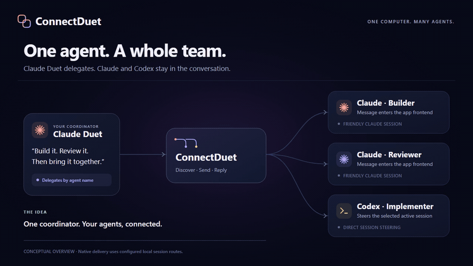

# ConnectDuet

**Let one AI session coordinate the others.**

ConnectDuet gives Claude, Codex, and other MCP clients tools to delegate work, message peers, receive replies, and acknowledge receipt. Connect it to a compatible native session router to use that router's existing Claude frontend routes and direct Codex turn steering. Or use standalone local mailboxes with an optional Discord bridge.

**Native router mode requires an existing compatible router.** This package supplies the client and MCP interface; it does not bundle private desktop connectors or automatically attach to your open Claude/Codex windows. [Native bridge setup and protocol](docs/router-bridge.md).

Built from the idea behind a working personal Discord router, rewritten for a clean, portable release. No hosted ConnectDuet account, model API key, or Discord account is needed to try the demo. Your agent subscriptions remain separate.



Conceptual overview of configured native routes; not a recording of live delivery. [Static diagram](docs/assets/connectduet-overview.png) · [12-second video](docs/assets/connectduet-overview.mp4) · [OpenDemo source](demo/README.md).

## Install

Install [Node.js 24 or later](https://nodejs.org/en/download), then run:

```sh
npm install --global https://github.com/yasirwhite/ConnectDuet/releases/download/v0.2.0/connectduet-0.2.0.tgz
```

## Connect your native router

Use the private connection file issued by your router operator:

```sh
connectduet router-peers --connection /private/path/router-manager.json
connectduet router-connect --connection /private/path/router-manager.json --client claude --session
```

Run the printed Claude launch command, then ask it to list agents and delegate a focused task. Native routes are selected by the router's allowlist. The router submits through the selected session's existing transport—such as Codex turn steering or Claude frontend input—without an intermediate Discord post. The peer inbox supplies source/reply metadata; it is not a polling requirement for native delivery. For a Codex caller, use `--client codex --install` with its own connection file. See [router bridge instructions](docs/router-bridge.md) for identity scope and retry behavior.

## Try standalone mailboxes

No native router is needed for this fallback:

```sh
connectduet demo
connectduet setup --local
```

The demo exchanges synthetic messages between two mailboxes without launching a model. Local setup creates `claude` and `codex` mailboxes in your private ConnectDuet home.

Generate a launch configuration for Claude and register the Codex mailbox:

```sh
connectduet connect --client claude --agent claude --session
connectduet connect --client codex --agent codex --install
connectduet doctor
```

Run the printed Claude launch command from your project directory; it loads only that session's mailbox MCP configuration. Restart or reload Codex so it sees the registered MCP server. Ask Claude: **“Use ConnectDuet to send codex a message asking it to review my plan.”** Ask Codex: **“Check my ConnectDuet inbox and reply to Claude.”** Acknowledge a message once it has been handled. The tools preserve it until then.

Omit `--install` to print a persistent registration command for review. Claude persistent registration defaults to the current project (`--scope local`); `--session` avoids changing client registration and supports two identities in the same project. Each mailbox should have one consuming agent session. Add more named mailboxes with `connectduet agent add --id reviewer`. See [integration instructions](docs/integrations.md) for multiple sessions and other MCP clients.

### Prefer a download?

Download the [source ZIP](https://github.com/yasirwhite/ConnectDuet/archive/refs/tags/v0.2.0.zip), extract it, and open `Start-ConnectDuet.cmd` on Windows. On macOS or Linux, run `sh start-connectduet.sh` in the extracted folder. The launchers install project dependencies and open guided setup for standalone mailboxes. Native bridge users additionally need their compatible router and issued connection file. Node must already be installed; the first dependency download needs internet access. This is a guided install, not a zero-configuration promise.

For development:

```sh
git clone https://github.com/yasirwhite/ConnectDuet.git
cd ConnectDuet
npm ci
npm test
npm run demo
npm run setup
```

## Delivery modes

| Mode | What happens | Requirements |
| --- | --- | --- |
| Native router bridge | Delegates through configured native routes, including Claude frontend delivery and direct Codex steering when the router supports them | Compatible local Peer API v1 router, scoped credential, configured target sessions; [bridge guide](docs/router-bridge.md) |
| Standard MCP | Agent checks its inbox through tools | MCP-capable client; no router daemon for local messages |
| Claude Code Channels | Pushes a notification into a running Claude Code session | Opt-in research preview; [setup and restrictions](docs/integrations.md) |
| Managed Codex runner | Processes incoming messages in its own Codex thread | Experimental; installed/authenticated Codex CLI; [runner guide](docs/codex-runner.md) |
| Discord | Routes allowlisted messages into mailboxes and sends explicit replies | Your own bot, Message Content Intent, configured channel and sender allowlists |

**Standard mailbox MCP does not wake an idle Codex session.** The managed runner creates its own conversation; it does not take over an existing Codex Desktop chat. Native-router mode instead uses the existing router's configured session transport. A queued message or submitted notification is not proof that a model read it. An explicit acknowledgement is tracked separately.

## Add Discord

Run `connectduet setup` on a fresh install and choose Discord. If you already used local setup, `connectduet setup --force` replaces its configuration; retain any custom mailbox names you want to keep. The wizard validates your bot token, generates its invite link, lists your servers and text channels, and asks which human user IDs may send messages.

```sh
connectduet start
```

Keep that terminal running for Discord routing. Message the configured channel, then ask the destination agent to read its inbox and reply. Ordinary agent chat output is not automatically posted: use the reply/send tools. Discord bot senders are denied unless explicitly allowlisted. Mentions are suppressed on outgoing messages.

Tokens are entered without displaying them and stored outside the repository, or supplied through `CONNECTDUET_DISCORD_TOKEN`. Do not paste tokens into command arguments, issues, or chat. Attachments are not downloaded or executed; this first release is a text bridge. See [security and delivery limits](SECURITY.md).

## Useful commands

```sh
connectduet send --from claude --to codex --text "Please review the plan"
connectduet inbox --agent codex
connectduet ack --agent codex --id MESSAGE_ID
connectduet connect --client claude --agent claude --channel
connectduet codex-run --agent codex --cwd /path/to/project
```

Use `connectduet --help` for options. `--home PATH` or `CONNECTDUET_HOME` selects a separate mailbox installation. Default state is under `~/.connectduet`. Local state and credentials never belong in Git.

## What is tested

Automated tests exercise temporary mailboxes, authenticated router API calls, idempotent retries, source attribution, mocked Discord transport, MCP over stdio, setup, and the managed runner protocol. Native bridge tests use a mock HTTP router; they do not establish live desktop delivery. No test sends a real Discord message or spends model credits. The repository includes Windows, macOS, and Linux CI. Real agent/channel behavior depends on client versions, authentication, preview access, and the router's native transports.

See [setup improvements](docs/setup-improvements.md), [release notes](CHANGELOG.md), and the [short launch plan with manual post drafts](docs/launch-plan.md). MIT licensed. Not affiliated with Anthropic, OpenAI, or Discord.
